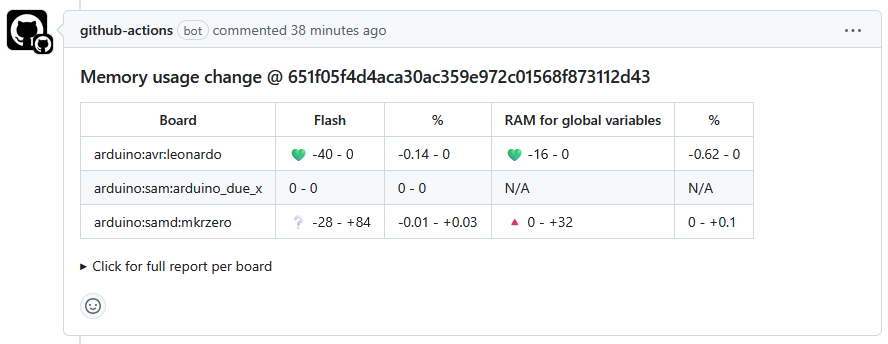
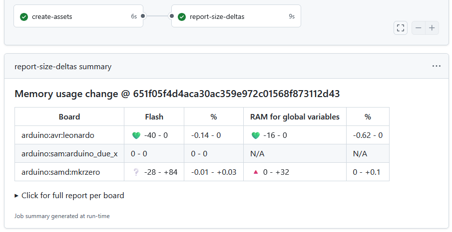

<!-- markdownlint-disable MD033 -->
# Arduino-report-size-deltas

[![rust-ci-badge]][rust-ci-runs] [![codecov-badge]][codecov-link]

[rust-ci-badge]: https://github.com/2bndy5/arduino-report-size-deltas/actions/workflows/rust.yml/badge.svg
[rust-ci-runs]: https://github.com/2bndy5/arduino-report-size-deltas/actions/workflows/rust.yml
[codecov-badge]: https://codecov.io/github/2bndy5/arduino-report-size-deltas/graph/badge.svg?token=W9SAQIH91A
[codecov-link]: https://codecov.io/github/2bndy5/arduino-report-size-deltas

A CLI tool designed for CI workflows that posts comments on a Pull Request about the memory size of Arduino sketches.

This is a port of [`arduino/report-size-deltas` GitHub action][original GitHub Action] from python to rust.

> [!NOTE]
> On Linux runners, especially when using a [`container`][jobs-container],
> `curl` is required to download the executable binaries used by this action.

[original GitHub Action]: https://github.com/arduino/report-size-deltas
[jobs-container]: https://docs.github.com/en/actions/reference/workflows-and-actions/workflow-syntax#jobsjob_idcontainer

## Inputs

### `sketches-reports-source`

The path to the folder containing sketches' reports (JSON files).

The default value is `"sketches-reports"` when not specified.

### `token`

The GitHub access token used to post comments on the Pull Request thread.
Uses `github.token` by default.

This is only used for Pull Request events.

## Example

The following example workflow will compile sketches, save reports as artifacts, and submit a summarizing comment.

```yml
name: Get Compile Size
on:
  push:
    branches: [main]
  pull_request:
    branches: [main]

jobs:
  compile-sketches:
    runs-on: ubuntu-latest
    strategy:
      matrix:
        fqbn: [arduino::avr::uno, arduino::samd::mkrzero]
    steps:
      - uses: actions/checkout@v4
      - uses: arduino/compile-sketches@v1
        with:
          fqbn: ${{ matrix.fqbn }}
          enable-deltas-report: true
      - uses: actions/upload-artifact@v4
        with:
          path: sketches-reports
          name: sketches-reports_${{ matrix.fqbn }}

  report-delta-size:
    needs: [compile-sketches]
    runs-on: ubuntu-latest
    permissions:
      # permission needed to create comments on a Pull Request
      pull-requests: write
    steps:
      - uses: actions/download-artifact@v4
        with:
          pattern: sketches-reports_*
          path: sketches-reports
      - name: Report size deltas
        uses: 2bndy5/arduino-report-size-deltas@v1.3.0
```

### Triggered by a `pull_request`

When this action is triggered by a `pull_request` event,
it will post a thread comment summarizing the change in compiled sizes.

In this scenario, the given [GitHub `token`](#token) needs
write permission for `pull-requests` (see example above) to post a comment.

<picture>
  <source media="(prefers-color-scheme: dark)" srcset="examples/pr-comment-dark.png">
  <source media="(prefers-color-scheme: light)" srcset="examples/pr-comment-light.png">
  
</picture>

Any existing report comment is updated.
If for some reason, there are multiple report comments found, then
all report comments except the latest are deleted.
And only the latest found report comment is updated.

Only comments created by this action are manipulated.

### Triggered by anything except `pull_request`

When this action is **not** triggered by a `pull_request` event,
it will append the summary comment to the workflow's run summary page.

<picture>
  <source media="(prefers-color-scheme: dark)" srcset="examples/step-summary-dark.png">
  <source media="(prefers-color-scheme: light)" srcset="examples/step-summary-light.png">
  
</picture>

In this scenario, no special permissions are needed.

## Why?

The [original GitHub Action] has some disadvantages:

- The [original GitHub Action] is lacking maintainer attention (beyond sporadic dependency updates).
- The [original GitHub Action] does not seem to be accepting new features. Contributions submitted by third-parties (community) get no maintainer feedback (other than maintainer-managed labels for issues or Pull Requests).
- The [original GitHub Action] requires a docker container to run the python code in isolation. This also means the [original GitHub Action] is only compatible with Linux-based CI runners.
- The [original GitHub Action] repository is bloated with metadata specifically used for development (not production).

## Goals

- [x] Mostly drop-in compatible with the [original GitHub Action].
  See [incomplete feature parity](#incomplete-feature-parity) below.
- [x] Simple enough to accept contributions from the community.
- [x] Does not require a docker container.
  Instead this CLI tool is deployed as a standalone binary that can be portably installed.
- [x] Data tables in the posted comment are more legible.
- [x] Support push events in a non-intrusive way:
  Instead of posting a comment to the commit's diff page, the report/comment is appended to
  the CI workflow run's summary page.
- [x] Use `schedule` events to work around the permissions needed to post PR comments. See [scheduled CI trigger](#scheduled-ci-trigger) below.

### Incomplete feature parity

Some features present in the [original GitHub Action] are not implemented in this port.
These features can be added upon request, but the utility of the feature should be "Generally Applicable";
meaning the feature does not just satisfy an individual use case.

### No [CSV] output

The [CSV] output used in the [original GitHub Action] is not included in this action's posted comment.
This is because [CSV] is a machine-readable syntax that is better served via programmatic means.
If you need [CSV] output, please submit a feature request so we can discuss the best approach toward integration.

[CSV]: https://en.wikipedia.org/wiki/Comma-separated_values

### Scheduled CI trigger

[schedule]: https://docs.github.com/en/actions/reference/events-that-trigger-workflows#schedule

Often called "cron jobs", the [original GitHub Action] supported GitHub's [schedule] workflow trigger.
This is useful because a workflow triggered by a Pull Request from a fork cannot be granted
write permissions to post a comment.

When the workflow is triggered by the [schedule] event, this action

1. Lists open Pull Requests (and their comments) using a single GraphQL query.
2. Lists the repository's artifacts named by `sketches-reports-source` (paginated, newest first)
   and matches them to each Pull Request's latest commit.
3. Downloads the artifact and posts (or updates) a report/comment for each Pull Request that
   does not already have a report for its latest commit.

Pull Requests that are locked, have no matching artifact, or already have an up-to-date report
cost no further requests.

In this mode, `sketches-reports-source` is the name of the artifact (not a folder),
and the [given `token`](#token) must have permission to read artifacts and write Pull Request comments.
The artifacts' JSON data/content is verified when generating the report;
artifacts that cannot be parsed are reported as failures for that Pull Request only.

Only the [schedule] event is supported. The `workflow_run` and `workflow_dispatch`
events are not (yet) handled specially.
